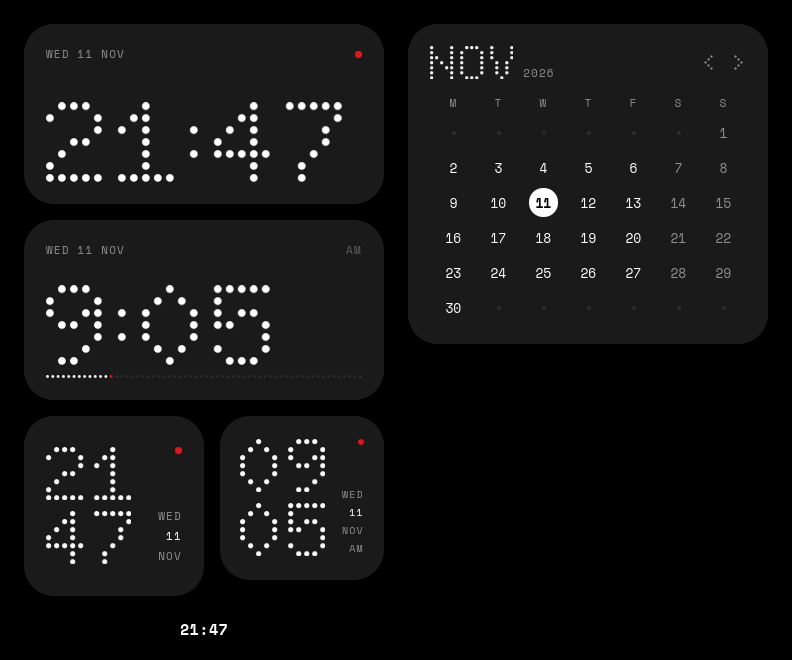
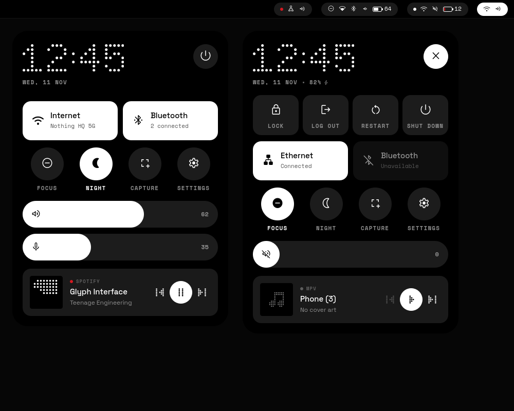
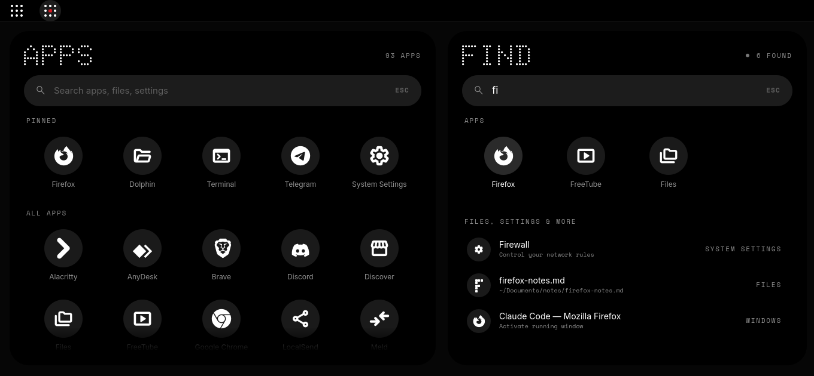

# NothingOS for CachyOS

Nothing OS design language for **KDE Plasma 6** (Wayland), built into Plasma itself:
pure black, white type, dot-matrix numerals and one red accent.


## What's inside

- **Desktop widgets** (real plasmoids): dot clock and calendar, weather, CPU/RAM dot rings, media
- **Top panel**: control center (Wi‑Fi, Bluetooth, focus, night light, volume) and an app drawer on the Meta key
- **Dock**, notifications in the theme, KRunner, Plasma desktop theme, colour scheme, window decoration
- **Live wallpapers**:
  - `org.nothing.dots`: a Glyph dot field with a dot-matrix character (Glam / Cute)
  - `org.nothing.dotimage`: turns any picture you choose into Nothing dot art
- **Lock screen, SDDM login and boot splash**
- **Icons**: monochrome places, apps, mimetypes and devices
- **Qt/GTK apps** via a Kvantum theme, Dolphin tuning, a Chrome theme
- **Terminals**: Alacritty, Konsole, Kitty, Ghostty, WezTerm, Starship, fastfetch, zsh/bash colours
- **`nothingd`**: a small Rust daemon (D-Bus) serving system, weather and network data to the widgets

| | |
|---|---|
|  |  |
|  |  |

## Install

Requires KDE Plasma 6.x on Wayland (developed on CachyOS / Plasma 6.7), Python 3 with
`fontTools`, `numpy` and `Pillow`, `rsvg-convert`, Qt 6 tools (`qsb`) and Rust (for `nothingd`).

```bash
git clone https://github.com/Really-y/NothingOS-for-CachyOS.git
cd NothingOS-for-CachyOS
scripts/install.sh            # backs up your current settings first
sudo sddm/install.sh          # optional: login screen
```

Undo everything with `scripts/restore.sh` (and `sudo sddm/install.sh --uninstall`).
See [`ARCHITECTURE.md`](ARCHITECTURE.md) and [`docs/`](docs/) for how it fits together.

## License

**CC BY 4.0** — see [`LICENSE`](LICENSE) and [`NOTICE.md`](NOTICE.md).
You may use and modify this project only if you **keep the original credit to Really-y
unchanged**, link back to this repository and state your changes. Bundled fonts and icons
keep their own licenses (OFL, Apache 2.0, CC0), listed in `NOTICE.md`.

"Nothing" is a trademark of Nothing Technology Limited. This is an independent fan
project, not affiliated with or endorsed by Nothing.
