<p align="center">
  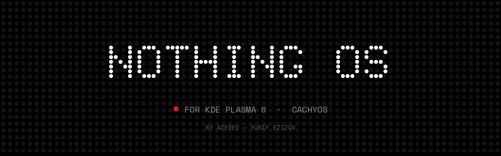
</p>

<p align="center">
  <a href="LICENSE"></a>
  
  
  
  
  <a href="https://azedev.com"></a>
</p>

<p align="center">
  <b>Nothing OS design language, built into KDE Plasma itself.</b><br>
  Pure black · white type · dot-matrix numerals · one red accent.<br>
  Real panels, real widgets, real lock and login screens: no separate shell.
</p>

<p align="center">
  <a href="#-highlights">Highlights</a> ·
  <a href="#-gallery">Gallery</a> ·
  <a href="#-install">Install</a> ·
  <a href="#-under-the-hood">Under the hood</a> ·
  <a href="#-license--credits">License</a>
</p>

---

<p align="center">
  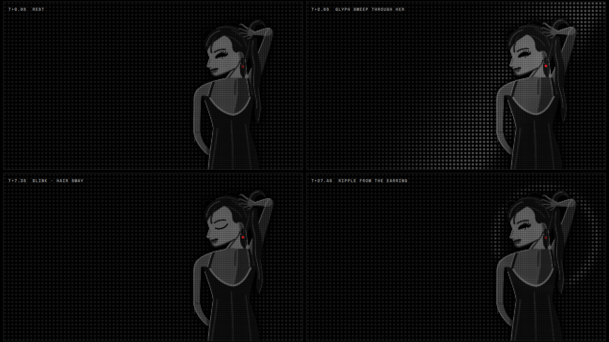
  <br><sub><b>org.nothing.dots</b> — live Glyph-field wallpaper with a dot-matrix character: breathing, blinking, hair sway, Glyph sweep and a red ripple.</sub>
</p>

## ● Highlights

| | |
|---|---|
| 🕐 **Desktop widgets** | Dot clock and calendar, weather, CPU/RAM dot rings, now playing: all real plasmoids |
| 🎛️ **Control center** | Wi‑Fi, Bluetooth, focus, night light, volume, media; unread notifications |
| 🔍 **App drawer and KRunner** | A Nothing launcher on the Meta key; KRunner as a black search pill |
| ⚫ **Dock** | A floating pill dock that replaces the task manager |
| 🖼️ **Two live wallpapers** | A Glyph field with a dot-matrix character (Glam / Cute), and **Dot Image**, which turns *any* picture into Nothing dot art |
| 🔒 **Lock, login and boot** | Lock screen with an idle mode, SDDM login theme and a "HELLO" dot boot splash |
| 🎨 **Everywhere else** | Plasma theme, colour scheme, window decoration, Kvantum (Qt), GTK, monochrome icons (apps, places, 1000+ mimetypes), Chrome theme |
| 💻 **Terminals** | Alacritty, Konsole, Kitty, Ghostty, WezTerm, Starship prompt, fastfetch dot logo, zsh/bash highlighting |
| 🦀 **`nothingd`** | A small Rust D‑Bus daemon serving system, weather (Open‑Meteo) and network data to the widgets |

## ● Gallery

### Widgets
<table>
  <tr>
    <td width="50%"><br><sub><b>Clock and calendar</b></sub></td>
    <td width="50%">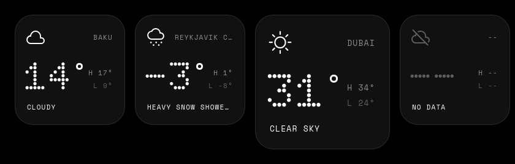<br><sub><b>Weather</b>, from Open‑Meteo via nothingd</sub></td>
  </tr>
  <tr>
    <td>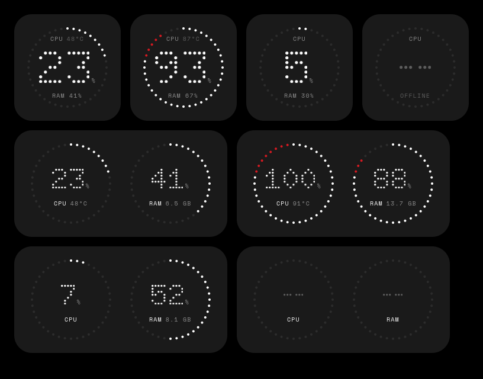<br><sub><b>System</b>: CPU and RAM dot rings</sub></td>
    <td>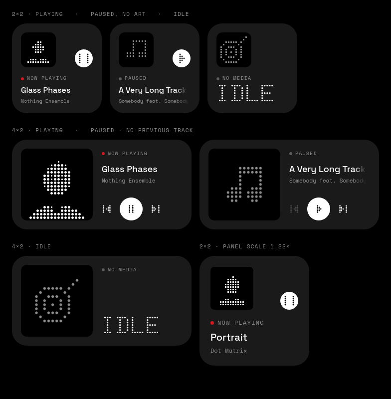<br><sub><b>Media</b>: halftone album art, MPRIS</sub></td>
  </tr>
</table>

### Panel, drawer and search
<table>
  <tr>
    <td width="50%"><br><sub><b>Control center</b></sub></td>
    <td width="50%">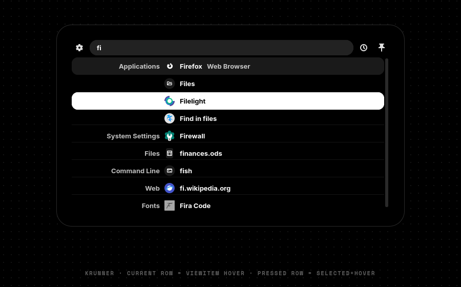<br><sub><b>KRunner</b></sub></td>
  </tr>
  <tr>
    <td colspan="2"><br><sub><b>App drawer</b>, opens with the Meta key</sub></td>
  </tr>
  <tr>
    <td colspan="2">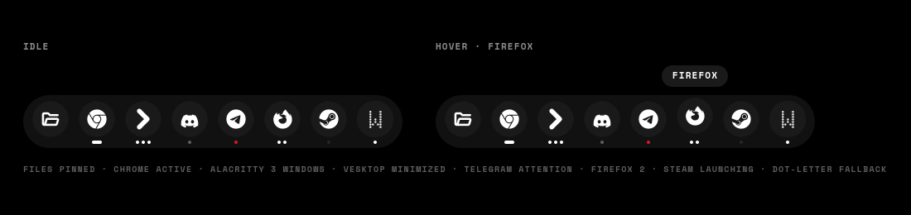<br><sub><b>Dock</b></sub></td>
  </tr>
</table>

### Lock, login and boot
<table>
  <tr>
    <td width="50%">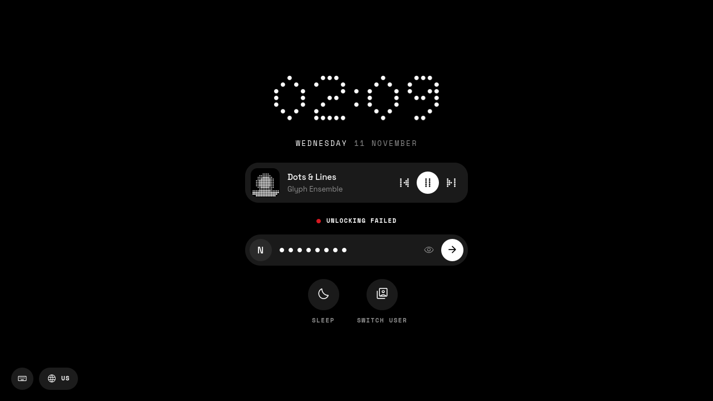<br><sub><b>Lock screen</b></sub></td>
    <td width="50%">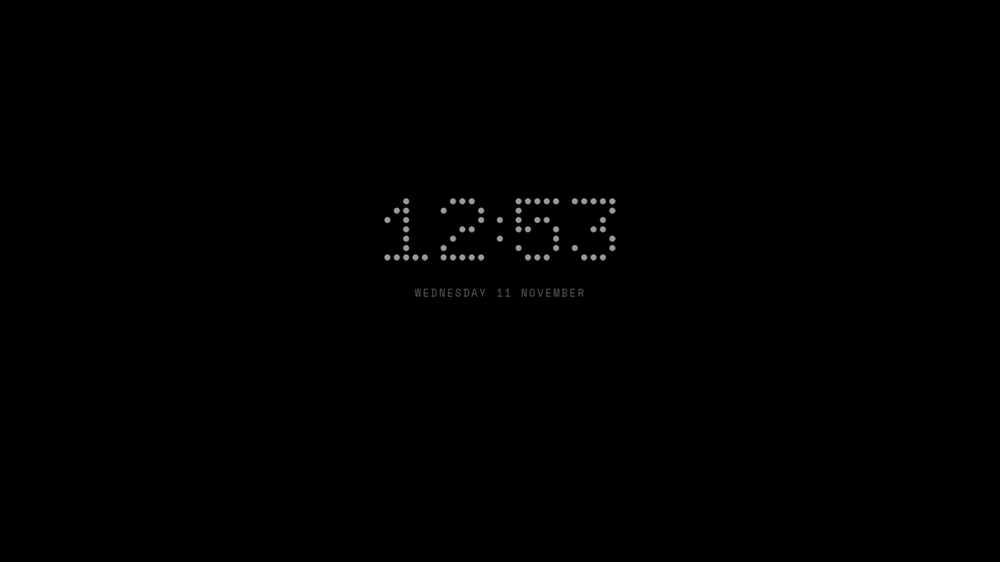<br><sub><b>Lock screen, idle</b></sub></td>
  </tr>
  <tr>
    <td>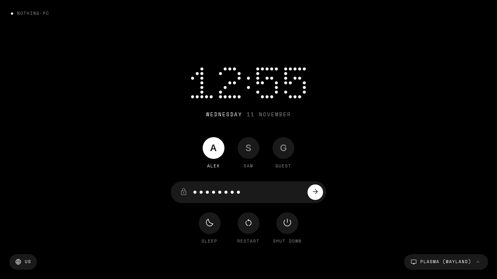<br><sub><b>SDDM login</b></sub></td>
    <td>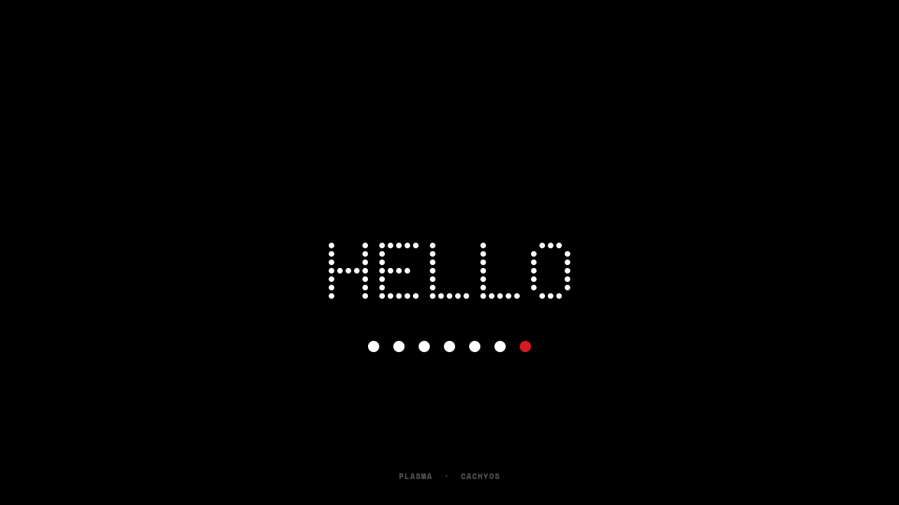<br><sub><b>Boot splash</b></sub></td>
  </tr>
</table>

### Live wallpapers
<table>
  <tr>
    <td width="50%">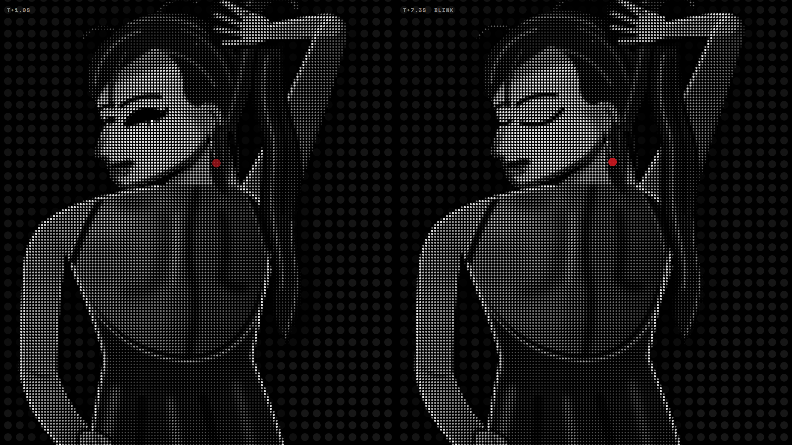<br><sub><b>Glyph field</b>, 1:1 detail</sub></td>
    <td width="50%">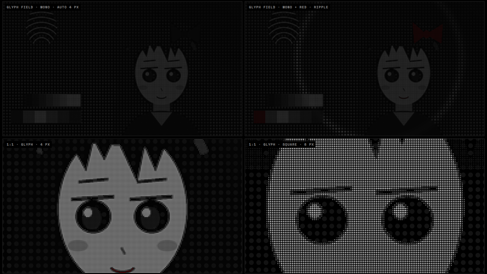<br><sub><b>Dot Image</b>: any picture becomes dot art</sub></td>
  </tr>
  <tr>
    <td colspan="2">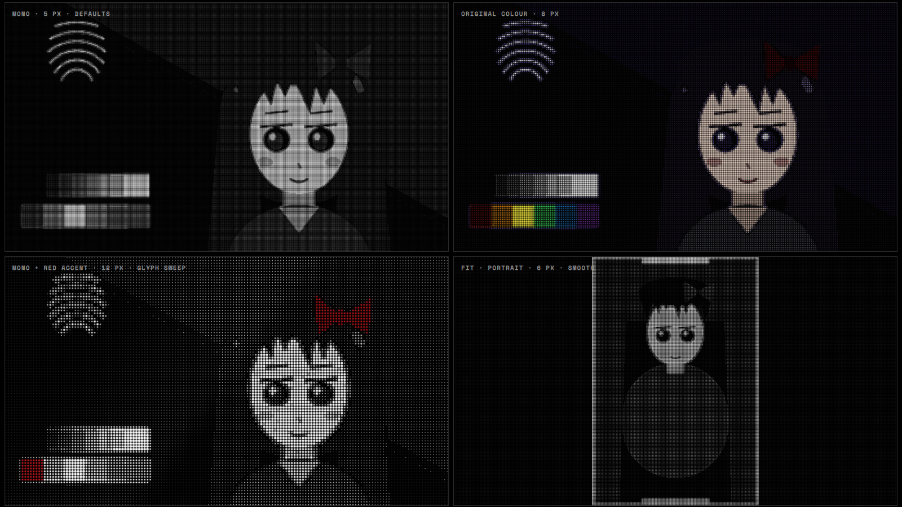<br><sub><b>Dot Image modes</b>: mono, original colour, mono + red accent, fit and edges</sub></td>
  </tr>
</table>

### Icons, apps and terminal
<table>
  <tr>
    <td colspan="2">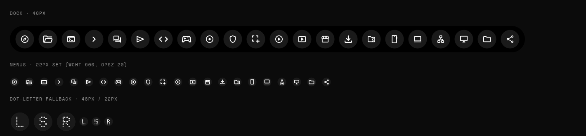<br><sub><b>Monochrome app icons</b>: brand marks and line glyphs</sub></td>
  </tr>
  <tr>
    <td width="50%">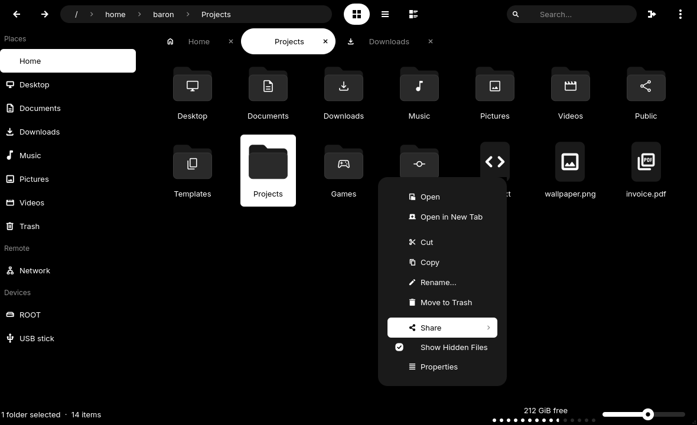<br><sub><b>Dolphin</b> with the Kvantum theme</sub></td>
    <td width="50%">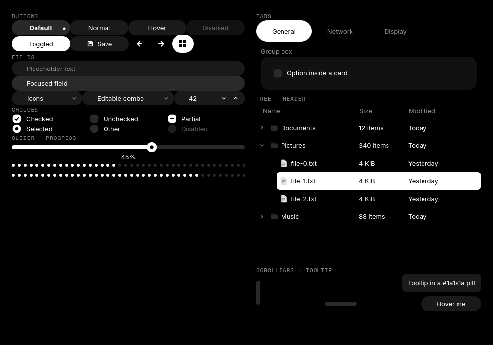<br><sub><b>Qt widgets</b></sub></td>
  </tr>
  <tr>
    <td colspan="2">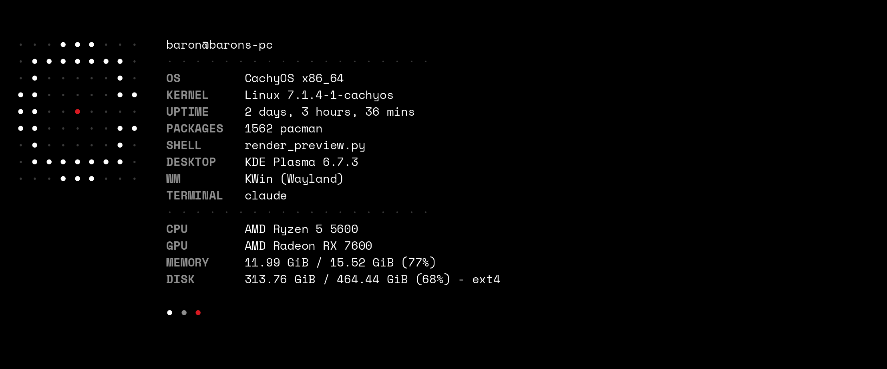<br><sub><b>Terminal</b>: fastfetch dot logo and Nothing palette</sub></td>
  </tr>
</table>

## ● Install

**Requirements:**
- KDE Plasma 6 on Wayland. Developed on CachyOS with Plasma 6.7.
- Python 3 with `fontTools`, `numpy` and `Pillow`
- `rsvg-convert`
- Qt 6 tools (`qsb`)
- Rust, for `nothingd`

```bash
git clone https://github.com/Really-y/NothingOS-for-CachyOS.git
cd NothingOS-for-CachyOS
scripts/install.sh          # backs up your current setup first, then installs everything
sudo sddm/install.sh        # optional: login screen
```

Log out and back in once.

**Undo:**
```bash
scripts/restore.sh
sudo sddm/install.sh --uninstall
```

<details>
<summary><b>Useful scripts</b></summary>

| Script | What it does |
|---|---|
| `scripts/install.sh` / `restore.sh` | Install everything, or put your original setup back |
| `scripts/build-plasmoids.sh` | Rebuild and reinstall the widgets |
| `scripts/build-wallpaper.sh` | Glyph live wallpaper (`--shaders` recompiles the shader) |
| `scripts/build-dotimage.sh` | Dot Image wallpaper |
| `scripts/defaults.sh` | One app per job (browser, files, terminal, archives); hides duplicates |
| `scripts/dolphin.sh` | Tunes Dolphin, including the Flatpak version |
| `terminal/gen_terminal.py --install` | Terminal themes, prompt and fastfetch |

</details>

## ● Under the hood

- **Design rules:** [`ARCHITECTURE.md`](ARCHITECTURE.md) covers colours, type (Doto, Inter, Space Mono), Material Symbols icons, radii and motion.
- **Shared UI kit:** one dot renderer for every numeral, ring and glyph (`plasma/plasmoids/shared/`).
- **`nothingd`:** a systemd user service on the session bus (`org.nothing.Daemon`).
- **Live wallpaper:** hand-drawn SVG art, baked into textures and rendered as dots by a GPU shader. See [`docs/live-wallpaper.md`](docs/live-wallpaper.md).
- **Safety:** the lock screen's password-checking code is byte-for-byte KDE's original; only the visuals changed.

## ● License and credits

<p>
  <b>NothingOS for CachyOS</b> — © 2026 <a href="https://azedev.com"><b>Azedev</b></a> — <b>Yusif Ezizov</b><br>
  Licensed under <a href="LICENSE"><b>Creative Commons Attribution 4.0 (CC BY 4.0)</b></a>.
</p>

You may use, share and modify this project, including commercially, **only if the
credit stays intact**. You must:
- keep the credit **"NothingOS for CachyOS by Azedev — Yusif Ezizov"** unchanged, with a link to this repository and to [azedev.com](https://azedev.com);
- keep [`LICENSE`](LICENSE) and [`NOTICE.md`](NOTICE.md);
- clearly state what you changed.

Removing or replacing the credit ends your permission to use this work.

Bundled fonts and icons keep their own licenses (SIL OFL 1.1, Apache 2.0, CC0); see [`NOTICE.md`](NOTICE.md).

<p align="center">
  <a href="https://azedev.com"><b>azedev.com</b></a> — built by Azedev
</p>

<sub>"Nothing" and "Nothing OS" are trademarks of Nothing Technology Limited. This is an independent fan project. It is not affiliated with or endorsed by Nothing, and it contains no Nothing OS code or assets.</sub>
